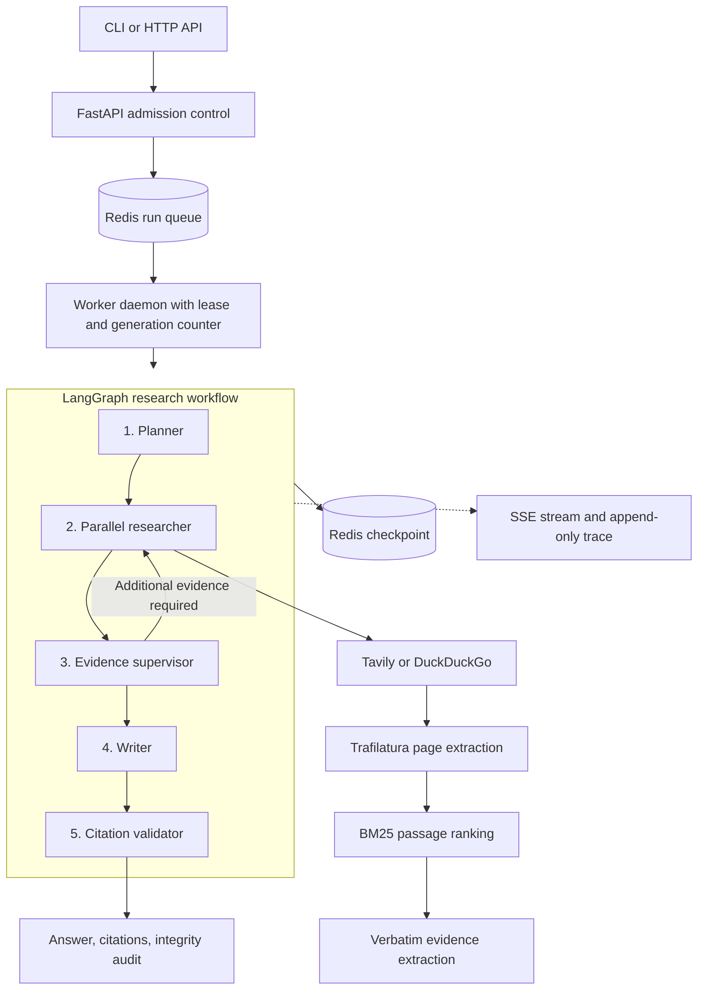

# Scout

A durable, budget-enforced, citation-verified multi-agent research assistant.

Scout conducts structured web research using free-tier language models and search providers. It decomposes a question into sub-questions, gathers source material in parallel, extracts evidence, evaluates coverage, synthesizes a report, and validates citations against the fetched page text.

[](https://www.python.org/)
[](https://github.com/langchain-ai/langgraph)
[](https://fastapi.tiangolo.com/)
[](https://redis.io/)
[](LICENSE)

## Contents

- [Overview](#overview)
- [How It Works](#how-it-works)
- [Architecture](#architecture)
- [Core Engineering Design](#core-engineering-design)
- [Features](#features)
- [Evaluation Results](#evaluation-results)
- [Getting Started](#getting-started)
- [CLI Usage](#cli-usage)
- [REST API](#rest-api)
- [Testing and Evaluation](#testing-and-evaluation)
- [Repository Structure](#repository-structure)
- [Limitations](#limitations)
- [Documentation](#documentation)
- [License](#license)

## Overview

Research agents must do more than produce plausible prose. They need to survive process failures, respect provider quotas, make their activity observable, and substantiate claims with sources that actually support them.

Scout is designed around those requirements. A research run is checkpointed in Redis, worker ownership is protected by leases and generation counters, resource budgets are checked before and during execution, and report citations are mechanically validated against stored evidence.

The project provides a FastAPI service, a background worker, and a command-line interface. It uses LangGraph to orchestrate the research workflow and is configured to operate with free-tier model and search-provider access. Actual availability, quotas, and latency depend on the providers and models configured for a run.

### Problems and design responses

| Problem | Scout's approach |
|---|---|
| A worker crash loses progress | Persist graph checkpoints in Redis and resume from the last committed checkpoint |
| Multiple workers act on the same run | Atomic Lua leases and generation counters fence out stale workers |
| Runs consume excessive resources | Enforce per-run and daily limits for time, model calls, tokens, searches, and page fetches |
| Reports contain unsupported citations | Match extracted evidence to fetched text and validate citation references before publication |
| Execution is difficult to inspect | Record ordered trace events and stream progress through Server-Sent Events (SSE) |

## How It Works

Scout uses a stateful LangGraph workflow with five stages.

| Stage | Responsibility |
|---|---|
| **Planner** | Decomposes a research question into specific, independent sub-questions |
| **Researcher** | Generates search queries, fetches pages with Trafilatura, ranks passages using BM25, and extracts evidence |
| **Supervisor** | Assesses evidence quality and requests targeted additional research within configured iteration limits |
| **Writer** | Synthesizes findings into a structured report |
| **Citation validator** | Validates report structure and checks that citations resolve to stored findings grounded in source text |

A completed run returns the answer first, followed by a numbered list of sources (title, URL, retrieval date, and the verbatim quote behind each citation).

## Architecture



For implementation details, see [System Architecture](docs/architecture.md).

## Core Engineering Design

### Durable execution and worker fencing

Run ownership is coordinated through Lua scripts in `src/scout/store/`:

- `acquire_lease.lua` grants exclusive run ownership and increments a generation counter.
- `renew_lease.lua` renews ownership while the worker remains active.
- `advance_commit.lua` permits checkpoint advancement only when the worker still holds the current generation.

If a worker fails or stalls, another worker can acquire the run and continue from the latest committed checkpoint. If the original worker later resumes, the generation check prevents it from committing stale state. Network side effects are tracked through the effect journal in `src/scout/effects/`, which also supports fault injection in tests.

### Resource-budget enforcement

Scout tracks usage in Redis ledgers across five dimensions:

- Wall-clock execution time
- Number of LLM calls
- Input and output tokens
- Search queries
- Page fetches

Admission control checks the daily allowance before accepting a run. During execution, the orchestrator enforces per-run limits. When a run reaches a configured limit, Scout can synthesize a partial report from the evidence already collected rather than continuing unbounded work.

### Citation and provenance validation

- Extracted findings must match the fetched page text verbatim.
- Final reports must conform to the Pydantic `ReportSchema v1`.
- Citations must resolve to stored findings before a report is published.

These checks validate whether a report's claims are grounded in the text Scout retrieved. They do not independently prove that a source is accurate, unbiased, or authoritative.

### Observability

Scout records model calls, tool calls, execution steps, and latency measurements in an ordered trace. The API streams progress using Server-Sent Events, including reconnect support with `Last-Event-ID`.

## Features

- **Crash-resilient runs:** Redis persistence and LangGraph checkpointing support recovery from interruptions.
- **Worker coordination:** Lua leases and generation counters protect run ownership and checkpoint commits.
- **Bounded resource use:** Admission control and in-flight ledgers enforce configured execution budgets.
- **Evidence-grounded reporting:** Findings are checked against retrieved page text and citations are validated before publication.
- **Live progress:** SSE streaming provides updates while a run is executing; the CLI shows the current stage and prints the answer as soon as the run finishes.
- **Trace inspection:** CLI and API commands expose run status, budget usage, execution steps, and latencies.
- **Two interfaces:** A Rich-based CLI and a REST API support interactive and programmatic use.

## Evaluation Results

The project includes an evaluation suite in [`data/eval_questions.jsonl`](data/eval_questions.jsonl). The following figures are reported in the repository's preliminary evaluation documents; reproduce the evaluation in your own environment before using them as a current benchmark.

### End-to-end performance

| Metric | Reported result | Target |
|---|---:|---:|
| Citation resolution rate | 100.0% | 100.0% |
| Verbatim snippet provenance | 100.0% | At least 90.0% |
| Mean LLM calls per run | 9.5 | At most 40 |
| Mean searches per run | 5.0 | At most 12 |
| Mean page fetches per run | 7.5 | At most 18 |
| Median wall-clock latency (p50) | 483.0 seconds | At most 300 seconds |
| p95 wall-clock latency | 577.2 seconds | Observed |

The reported median latency is above the target. The evaluation notes attribute latency to queuing and rate limiting on free-tier providers.

### Planner evaluation

The planner rubric was evaluated over 10 complex questions and 30 generated sub-questions.

| Metric | Reported score | Threshold |
|---|---:|---:|
| Sub-question specificity | 4.67 / 5 | At least 4.0 / 5 |
| Sub-question independence | 5.00 / 5 | At least 4.0 / 5 |

### Thin-slice acceptance checks

| Check | Target | Reported result |
|---|---|---|
| Finding provenance | At least 90% verbatim matching | 100.0% |
| Fetch success | At least 60% usable text | 100.0% |
| Citation resolution | 100% resolved | 100.0% |
| Report usefulness | At least 3 of 5 reports useful | 5 of 5 |
| Quota feasibility | Within 7 calendar days | Confirmed for the reported smoke run |

Detailed results and methodology are available in [Preliminary Evaluation](docs/preliminary_eval.md), [Planner Evaluation](docs/planner_eval.md), [Quota Reconnaissance](docs/quota_recon.md), and [Evaluation Decisions](docs/DECISIONS.md).

## Getting Started

### Prerequisites

- Python 3.11 or 3.12 (Python 3.12 recommended)
- [uv](https://docs.astral.sh/uv/) for Python environment and dependency management
- Redis 7 or later, with append-only file (AOF) persistence enabled
- An OpenRouter API key for model access
- A Tavily API key if using Tavily search

DuckDuckGo is also supported by the search integration. Model selection, quotas, budgets, and timeouts are defined in [`config/settings.yaml`](config/settings.yaml).

Every agent role uses the free OpenRouter model `poolside/laguna-s-2.1:free` by default. Free models can be retired without notice; if runs fail with `provider_unavailable`, choose another `:free` model on [OpenRouter](https://openrouter.ai/models?max_price=0) and update the `model` field of each role in `config/settings.yaml`.

### 1. Clone the repository

```bash
git clone https://github.com/Git-Kapish/Scout.git
cd Scout
uv sync
```

### 2. Start Redis

Use the repository's Docker Compose configuration:

```bash
docker compose up -d
```

Alternatively, run Redis locally and make it available at the address configured for Scout.

### 3. Configure environment variables

Copy the example environment file:

```bash
cp .env.example .env
```

Set the required values in `.env`:

```ini
OPENROUTER_API_KEY=your_openrouter_api_key
TAVILY_API_KEY=your_tavily_api_key
REDIS_URL=redis://127.0.0.1:6379/0
SCOUT_MODE=live
```

Keep API keys out of source control. Provider free-tier availability and quotas can change; check provider dashboards before running large workloads.

### 4. Start the API and worker

Start the API server in one terminal:

```bash
uv run uvicorn scout.api.main:app --port 8000 --reload
```

Start the worker in a second terminal:

```bash
uv run scout worker
```

## CLI Usage

### Interactive research shell

Launch the interactive shell:

```bash
uv run scout
```

### Submit a single query

```bash
uv run scout ask "What are the trade-offs between Redis and SQLite?"
```

The command shows live progress and then prints the result in the same terminal; a separate `scout status` call is not needed:

```text
● Planned 3 sub-questions
  1. How does Redis persist data to disk?
  2. How does SQLite handle concurrent writes?
  3. ...
  ↳ 4 verified findings for sq_1
● Sub-questions: 1 accepted
⠋ Researching: How does SQLite handle concurrent writes?… (94s · Ctrl+C to detach)

─────────────────────────────── Answer ───────────────────────────────
Redis vs SQLite
Executive Summary: ...
Durability
 • Redis persists snapshots and an append-only file. [1]

──────────────────────────── Sources (9) ─────────────────────────────
[1] Redis persistence
    https://redis.io/docs/latest/operate/oss_and_stack/management/persistence/
    Retrieved 2026-10-21 09:12 UTC
    "Redis provides a range of persistence options ..."
──────────────────────────────────────────────────────────────────────
9/9 claims cited · 15 LLM calls · 24,826 tokens · 6 searches · 258s · run run_3f2a...
```

- On an interactive terminal the answer is streamed in progressively. Set `SCOUT_NO_STREAM=1`, or pipe the output, to print it at once.
- Ctrl+C detaches from the run without cancelling it. Reattach with `uv run scout watch <run_id>`.
- If a run fails or is cancelled, the CLI prints the reason, the provider's error message, and a suggested next step, such as `uv run scout resume <run_id>` after a quota reset.

### Command reference

| Command | Description |
|---|---|
| `uv run scout` | Open the interactive research shell |
| `uv run scout ask "<query>"` | Research a question and print the answer and sources when it finishes |
| `uv run scout run "<query>"` | Same as `ask`; add `--no-watch` to submit and return immediately |
| `uv run scout watch <run_id>` | Reattach to a run: live progress, then its answer or failure reason |
| `uv run scout status <run_id>` | View run status and the rendered report, or why the run failed |
| `uv run scout trace <run_id>` | Inspect ordered execution steps and latencies |
| `uv run scout cancel <run_id>` | Request cancellation of an active run |
| `uv run scout resume <run_id>` | Resume a stalled or interrupted run |
| `uv run scout runs list` | List active, completed, and stalled runs |
| `uv run scout runs purge` | Remove unleased or stalled runs from the active registry |
| `uv run scout worker` | Start the background worker daemon |

See the [CLI and API Guide](docs/cli_and_api_guide.md) for additional usage details.

## REST API

The FastAPI application exposes the following endpoints:

| Method | Endpoint | Description |
|---|---|---|
| `POST` | `/research` | Submit a research run with admission control and idempotency |
| `GET` | `/research/{run_id}` | Retrieve status, budget usage, and the final Markdown report |
| `GET` | `/research/{run_id}/events` | Stream progress using SSE, with reconnect support |
| `POST` | `/research/{run_id}/cancel` | Request cancellation of an active run |
| `POST` | `/research/{run_id}/resume` | Resume a stalled run under a renewed lease |
| `GET` | `/research/{run_id}/trace` | Retrieve the execution trace and latency data |
| `GET` | `/health` | Check the configured Redis, search, and LLM dependencies |

### Example request

Submit a research question:

```bash
curl -X POST http://127.0.0.1:8000/research \
  -H "Content-Type: application/json" \
  -d '{"question": "Compare the performance trade-offs between Redis and SQLite"}'
```

Stream progress using the returned run ID:

```bash
curl -N http://127.0.0.1:8000/research/<RUN_ID>/events
```

## Testing and Evaluation

Run the test suite:

```bash
uv run pytest -q
```

Useful focused test commands:

```bash
uv run pytest tests/test_citation_validator.py
uv run pytest tests/test_fencing_lua.py
uv run pytest tests/test_cli.py
```

Reproduce the evaluation scripts:

```bash
# Inspect provider quotas
uv run python scripts/quota_recon.py

# Evaluate planner quality
uv run python scripts/eval_planner.py

# Run the end-to-end evaluation
uv run python scripts/run_eval.py
```

The repository documentation describes 75+ unit and integration tests. Run the commands above to establish the current result in your environment.

## Repository Structure

```text
Scout/
├── config/
│   └── settings.yaml       # Models, budgets, and timeouts
├── data/                   # Evaluation questions, cache, and run snapshots
├── docs/                   # Architecture, guides, decisions, and evaluation reports
├── results/                # Machine-readable evaluation results
├── scripts/                # Evaluation and quota-analysis utilities
├── src/scout/
│   ├── agents/             # Planner, researcher, supervisor, and writer
│   ├── api/                # FastAPI routes, admission control, and SSE
│   ├── effects/            # Effect journal and fault injection
│   ├── extract/            # BM25 passage ranking and verbatim matching
│   ├── graph/              # LangGraph workflow
│   ├── llm/                # Model clients and rate-limit handling
│   ├── search/              # Tavily and DuckDuckGo integrations
│   ├── store/               # Redis Lua scripts, keys, ledgers, and export
│   ├── trace/               # Structured execution tracing
│   ├── validate/            # Citation and schema validation
│   ├── cli.py               # CLI and interactive shell
│   └── worker.py            # Background worker and lease loop
└── tests/                   # Unit and integration tests
```

## Limitations

- **Latency:** Free-tier providers may queue or rate-limit requests. The reported median evaluation latency is several minutes.
- **Provider quotas:** Search and free-model quotas constrain throughput and availability.
- **Source quality:** Scout checks whether claims are grounded in retrieved text, but it does not establish whether that text is accurate, unbiased, or authoritative.
- **External dependencies:** Results depend on search-provider availability, webpage accessibility, and the selected model's behavior.

## Documentation

| Document | Description |
|---|---|
| [System Architecture](docs/architecture.md) | Workflow, persistence, lease, and state mechanics |
| [CLI and API Guide](docs/cli_and_api_guide.md) | Command-line and REST API reference |
| [Evaluation Decisions](docs/DECISIONS.md) | Evaluation gates and quota calculations |
| [Preliminary Evaluation](docs/preliminary_eval.md) | Reported baseline metrics |
| [Planner Evaluation](docs/planner_eval.md) | Planner rubric and scores |
| [Quota Reconnaissance](docs/quota_recon.md) | Provider quota investigation |
| [Product Requirements](PRD.md) | Product goals and requirements |

## License

Scout is released under the [MIT License](LICENSE).
