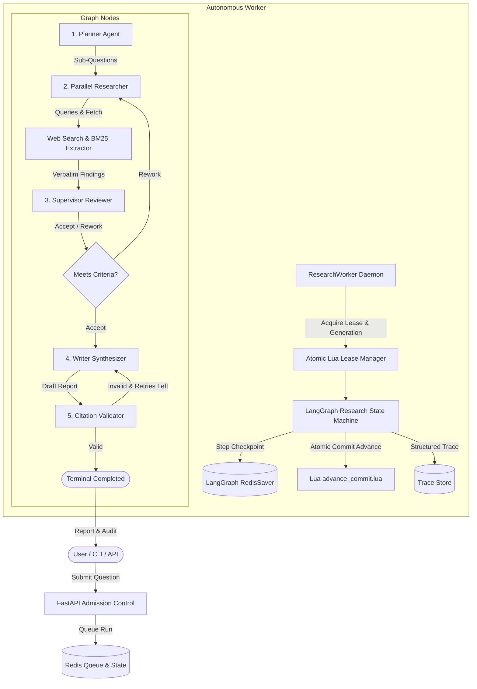

# Scout System Architecture & Operational Mechanics

Scout is an autonomous, durable, budgeted, and traceable multi-agent research assistant designed to operate reliably on free-tier LLM providers (e.g., OpenRouter `:free` models) and under strict zero-dollar ($0) spend constraints.

---

## 1. High-Level Architecture

Scout separates high-level coordination, web search, verbatim evidence extraction, quality supervision, and final report synthesis into specialized nodes operating over a stateful LangGraph execution cycle.

---

## 2. Core Subsystems

### 2.1 Atomic Lease Management & Fencing (`scout.store.lua_scripts`)
To survive abrupt process termination, Kubernetes pod evictions, or node failures without split-brain anomalies or duplicate side-effects, Scout enforces strict worker fencing:

1. **Monotonically Increasing Generation**:
   Whenever a worker acquires or resumes a research run, `acquire_lease.lua` atomically increments the run's fencing generation counter (`run:{id}:generation`) and sets the active lease key (`run:{id}:lease`) with a TTL.
2. **Heartbeat Renewal**:
   A dedicated background daemon thread renews the lease via `renew_lease.lua` every `heartbeat_interval_s` (default 2s, TTL 15s).
3. **Atomic Commit Pointer**:
   When LangGraph completes an execution step, `advance_commit.lua` verifies that the active worker's generation matches `run:{id}:generation` before updating `run:{id}:committed` with the `checkpoint_id` and `seq` counter.
4. **Stale Worker Eviction**:
   If a worker process freezes or stalls, another worker can safely claim the lease after TTL expiration. Any superseded worker attempting to write state receives an explicit `generation_superseded` error and halts immediately.

### 2.2 Admission Control & Hard Budgets (`scout.api.routes.research`, `scout.store.ledgers`)
Free-tier providers enforce strict rate limits (e.g., 50 requests/day at 20 RPM). Scout does not rely on prompt suggestions to limit usage:

- **Admission Control**:
  Before accepting a new run (`POST /research`), Scout projects whether the run's reserve budget ($\le 35$ LLM calls) fits within the remaining daily quota. If projected usage exceeds remaining capacity, Scout rejects the submission with HTTP 429 and returns a `retry_after_s` delay.
- **Hardware-Enforced Run Budgets**:
  Every LLM call, token usage, search query, and page fetch increments Redis hash counters (`run:{id}:budget`). If any limit (e.g., 40 LLM calls or 1,200s wall-clock time) is exceeded, the orchestrator triggers an immediate graceful termination to synthesize whatever evidence has been gathered.

### 2.3 Verbatim Evidence Extraction & Mechanical Verification (`scout.extract`)
Scout prevents hallucinated facts from entering research reports through a two-stage verification barrier:

1. **BM25 Passage Filtering**:
   Web pages fetched by Trafilatura are tokenized and scored with BM25Okapi against the sub-question. Only the top-5 most relevant paragraphs ($\le 1,500$ tokens) are forwarded to the extraction model.
2. **Exact Verbatim String Matching**:
   When the Researcher agent extracts candidate findings, Scout's mechanical provenance validator searches the raw fetched HTML/text for the exact finding quote. If the text does not match verbatim in the source document, the finding is discarded before reaching the findings ledger.

### 2.4 Citation & Schema Integrity Validator (`scout.validate.citation_validator`)
When the Writer agent drafts the final report:
- Every claim in the report must be explicitly tied to a verified `finding_id` and bibliography index (`[1]`, `[2]`, ...).
- The validator checks:
  - That all cited reference indices exist in the bibliography.
  - That cited sources match the verified finding records in Redis.
  - That no uncited or orphaned claims are present.
- If citations fail validation, the Supervisor sends targeted feedback to the Writer for a regeneration pass. If regenerations are exhausted, Scout issues a completed-partial status with a detailed audit trail.

---

## 3. Real-Time Event Streaming & Observability

Scout provides end-to-end observability via Redis Streams and Server-Sent Events (SSE):

- **Event Stream (`run:{id}:events`)**:
  Every state transition, search execution, page fetch, finding extraction, supervisor review decision, and budget warning publishes a structured SSE event.
- **Ordered Step Trace (`run:{id}:trace`)**:
  Step latencies, tool calls, model names, tokens used, and preview outputs are preserved in an immutable trace log accessible via `/research/{id}/trace`.
- **Live Reconnect Semantics**:
  The SSE stream supports the standard HTTP `Last-Event-ID` header, enabling seamless live reconnection across network drops without losing state updates.
